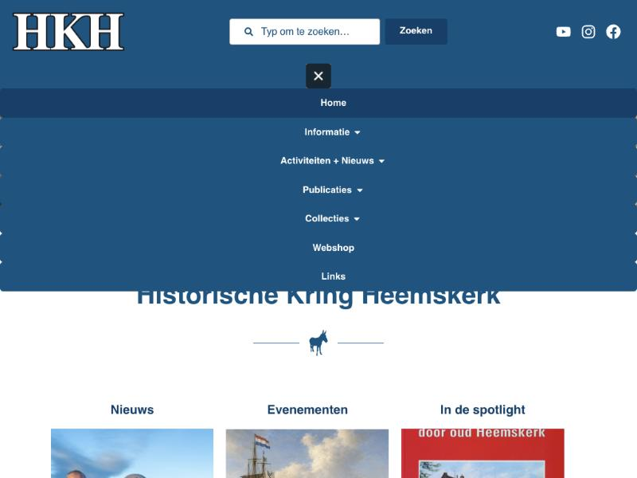

# Vragen stellen aan ons archief

Voorstel om bezoekers in gewone taal te laten zoeken in alles wat de Historische Kring Heemskerk heeft verzameld, met hulp van kunstmatige intelligentie (AI).

Voorstel voor het bestuur · oktober 2026

## In het kort

De HKH heeft ruim 18.000 foto's, documenten, boeken, bidprentjes en Heemskring-artikelen gedigitaliseerd. Wie daar iets in wil vinden, moet nu weten in welke van de zes beeldbanken het staat en welk zoekwoord werkt. Dit voorstel voegt één vraagveld toe: je typt een vraag zoals je die aan een vrijwilliger zou stellen, en een digitale onderzoeker zoekt in alle collecties tegelijk, schrijft een samenvatting en zet er de bronnen bij.

### Wat wordt gevraagd

- Aanschaf van een computer voor het Historisch Huis: eenmalig ongeveer € 900.
- Een AI-abonnement van € 18 per maand (maandelijks opzegbaar). Alleen bij veel gebruik is een zwaarder abonnement van € 90 per maand nodig.
- Evaluatie na een half jaar: wordt het gebruikt, en wat kost het werkelijk?

Eerste jaar in totaal ongeveer € 1.100; daarna ruim € 200 per jaar.

De techniek is al gebouwd en getest. Het enige dat ontbreekt om het voor iedereen aan te zetten, is de computer en het abonnement. U kunt het zelf proberen op de proefomgeving; zie de laatste pagina.

Vragen over dit voorstel: robbert@vdzon.com

## 1. Waar bezoekers nu tegenaan lopen

Onze collecties zijn goed beschreven, maar verdeeld over zes aparte beeldbanken, elk met een eigen zoekscherm en eigen zoekvelden. Een bezoeker die wil weten wat er bekend is over bijvoorbeeld de aardbeienteelt, moet:

- weten dat er een archiefbank, een fotobank, een bibliotheekbank, een bidprentjesbank, een artikelenbank en een objectenbank zijn;
- in elke bank apart zoeken, met het juiste zoekwoord en het juiste veld;
- de gevonden stukken zelf lezen en combineren tot een antwoord.

Dat lukt onze eigen vrijwilligers, maar een inwoner, een leerkracht of een stamboomonderzoeker haakt vaak af voordat hij iets gevonden heeft. Het werk van jaren digitaliseren wordt daardoor minder gebruikt dan het verdient.

## 2. Wat het wordt: één vraagveld

De bezoeker ziet een eenvoudig scherm met één veld. Hij typt een vraag in gewone taal. De digitale onderzoeker doorzoekt alle collecties, leest de gevonden stukken en schrijft een samenvatting. Onder elk antwoord staat de lijst met bronnen, met een link naar het originele stuk in onze eigen collectie. Elk antwoord is dus te controleren.

Wie liever zelf zoekt, kan dat blijven doen: de bestaande zoekschermen met filters op straat, thema, periode en auteur blijven bestaan en zijn vanaf hetzelfde scherm bereikbaar.

## 3. Een echt voorbeeld

Hieronder staat, letterlijk overgenomen, het antwoord dat de digitale onderzoeker op de proefomgeving gaf op de vraag "Wat is er bekend over de aardbeienteelt in Heemskerk?". Het antwoord is in één zoekronde gemaakt en kostte 2 minuten en 13 seconden.

> **De aardbeienteelt in Heemskerk**
>
> Ongeveer een eeuw lang, van grofweg 1860 tot 1970, was de aardbei hét gewas van Heemskerk. Volgens de Heemskring was in de bloeitijd tweederde van Heemskerk en Beverwijk bedekt met aardbeienplanten, en de Heemskerkse aardbeien stonden bekend om hun geur, volle smaak en zoetheid (Watertanden bij een ouderwetse slof aardbeien).
>
> **Begin en bloei**
>
> De tuinderij zoals we die nu kennen begon volgens het artikel over de familie Scheerman omstreeks 1850. Toen ging men aardbeien, bessen en sla telen (De familie Scheerman: een tuindersgeslacht). Rond 1880–1890 werd veel grond van het landgoed Commandeurs ontgonnen tot tuinderij en in kleine percelen verpacht aan de tuinders uit het dorp. De opbrengst wisselde sterk: bij extreem weer kon de oogst, vooral van aardbeien, deels of helemaal mislukken. Dan konden de tuinders de pacht niet betalen, en jhr. mr. Hugo Gevers van Marquette gaf hun vaak uitstel (Commandeurs).
>
> Ook volgens een artikel over het tuinbouwonderwijs was de aardbei jarenlang het meest geteelde product in Heemskerk, op tweederde van de tuinbouwgrond. Veel van de oogst ging naar Duitsland en Engeland, waar er jam van werd gemaakt. Een verslag van rond 1900 laat zien hoe groot de teelt was: Heemskerk had 103 ha aardbeien, tegen 82 ha in Velsen, 73 ha in Wijk aan Zee en Duin, 8 ha in Heiloo en 5 ha in Beverwijk (Onderwijs, onderzoek en voorlichting in de tuinbouw).
>
> **Rassen: van Anna tot Moulin Rouge**
>
> Eerst teelde men vooral de kleine 'Anna' (Fragaria vesca), een veredelde bosaardbei. Jan Beentjes, bijgenaamd 'De Snijder', zou het ras Jucunda in Kennemerland hebben geïntroduceerd. Hij leerde het ras rond 1840 kennen tijdens zijn militaire dienst in Oost-Indië en nam in 1842 stekken mee naar Heemskerk. In de regio heette het ras 'Amazone', naar het telegramadres van Veiling Kennemerland. Vanaf 1870 werd het op grote schaal geteeld, vooral voor de conservenfabrieken. Rond 1940 werd het verdrongen door de Obersleziën, hier bekend als 'Moulin Rouge' ('Molleroesj'), genoemd naar de Beverwijkse Exportveiling. Andere rassen waren de Beverwijkse Export, de Zoete Fransje en de Frau Mieze Schindler (Watertanden bij een ouderwetse slof aardbeien).
>
> Het antwoord gaat nog verder met de kopjes: Tuimelaars en sloffen, Pluk, veiling en verkoop, Plukverlof en Marialiederen, Bijzondere gebeurtenissen, Het einde. In totaal ruim 1.000 woorden.
>
> Bronnen onder het antwoord (22: 10 Heemskring-artikelen, 7 foto's, 4 archiefstukken, 1 objecten), elk aanklikbaar naar het originele stuk: Watertanden bij een ouderwetse slof aardbeien; De familie Scheerman: een tuindersgeslacht; Commandeurs; Onderwijs, onderzoek en voorlichting in de tuinbouw; De hakhoutcultuur; Aardbeien mandje; Aardbeien; Straten Heemskerkerduin; Heemskerkse wandelroute; Schoolverzuim in Heemskerk tussen 1920 en 1930; en nog 12 andere stukken.

Op het scherm staat bij elk antwoord de waarschuwing dat het door AI is samengesteld en dat de bronnen leidend zijn; foto's uit de collectie zijn in deze afdruk weggelaten.

## 4. Hoe het werkt

Drie stappen:

1. **Onze collecties.** De beeldbanken zoals ze nu zijn. Daar verandert niets aan; de vrijwilligers blijven er op dezelfde manier in werken.
2. **Een computer in het Historisch Huis.** Hierop draait de digitale onderzoeker. Hij houdt een doorzoekbare kopie van de collecties bij en doet het zoekwerk.
3. **Het antwoord op de website.** De AI-dienst (het abonnement) formuleert uit de gevonden stukken een leesbare samenvatting met bronnen.

De collecties blijven van ons en staan op onze eigen computer. Naar de AI-dienst gaan alleen de vraag en de teksten van de gevonden archiefstukken; er gaan geen gegevens van leden naar buiten.

## 5. Wat het kost

| Onderdeel | Eenmalig | Per maand | Per jaar |
|---|---|---|---|
| Computer in het Historisch Huis | € 900 | – | – |
| AI-abonnement bij normaal gebruik | – | € 18 | € 216 |
| AI-abonnement bij veel gebruik (alleen als het druk wordt) | – | € 90 | € 1.080 |

Eerste jaar: ongeveer € 1.100 (computer plus abonnement). Daarna: ruim € 200 per jaar. Alleen als het zo populair wordt dat het drukker is dan verwacht, groeit dat naar ongeveer € 1.100 per jaar. Het abonnement is maandelijks opzegbaar; de computer blijft hoe dan ook bruikbaar voor de werkgroepen.

## 6. Wat er al is

Dit is geen plan op papier: de zoekfunctie werkt al op een proefomgeving, met een kopie van onze collecties. Daar is de afgelopen maanden mee getest. Het besluit gaat alleen over de computer en het abonnement om het voor iedereen beschikbaar te maken.

## 7. Vragen die u misschien heeft

**Kan de AI onzin vertellen?**
Ja, dat kan voorkomen. Daarom staat bij elk antwoord de bronnenlijst en de waarschuwing dat het een hulpmiddel is. De bron is altijd ons eigen archiefstuk; dat kan de bezoeker zelf nalezen.

**Wat als niemand het gebruikt?**
Dan zeggen we het abonnement op; het kost dan niets meer. De computer blijft bruikbaar in het Historisch Huis.

**Wat als het juist heel druk wordt?**
Dan stappen we over op het zwaardere abonnement van € 90 per maand. Dat is een luxeprobleem: het betekent dat de collectie eindelijk gebruikt wordt.

**Hoe zit het met privacy?**
Er gaan geen ledengegevens naar buiten. Alleen de gestelde vraag en de gevonden archiefteksten worden naar de AI-dienst gestuurd om het antwoord te formuleren.

**Wie onderhoudt het?**
De installatie en het onderhoud worden door de indiener van dit voorstel verzorgd; de werkgroepen hoeven niets anders te doen dan nu.

## 8. Gevraagd besluit

Het bestuur gaat akkoord met de aanschaf van een computer voor het Historisch Huis (ongeveer € 900) en een AI-abonnement van € 18 per maand, en evalueert na een half jaar het gebruik en de kosten.

## Zelf proberen

De proefomgeving staat op https://hkh.vdzonsoftware.nl. Typ een vraag en klik op "Zoek"; het antwoord verschijnt meestal binnen twee minuten. Probeer bijvoorbeeld:

- Wat is er bekend over de aardbeienteelt in Heemskerk?
- Wie woonden er rond 1900 aan de Kerkweg?
- Wat gebeurde er in Heemskerk tijdens de Tweede Wereldoorlog?

Onderaan het zoekscherm staat een schakelaar "Nieuwe website". Daarachter staat, ter kennismaking, een proefversie van een vernieuwde website met dezelfde inhoud als de huidige site. Daar hoeft het bestuur nu niets over te besluiten.
