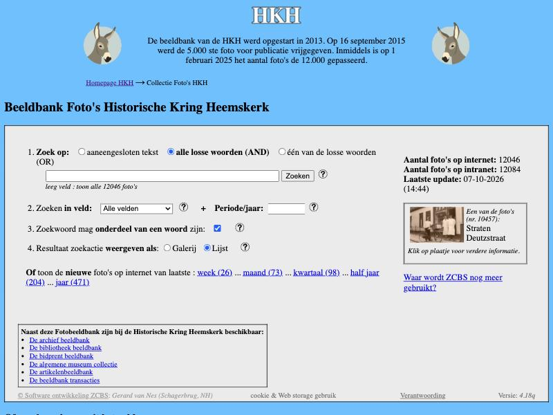
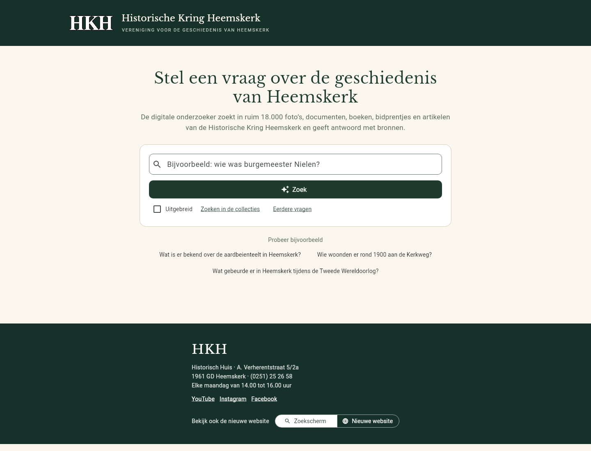
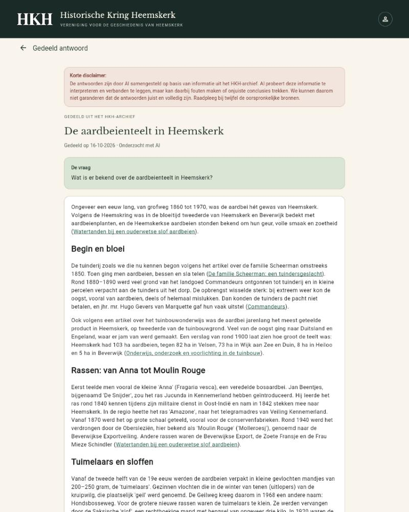
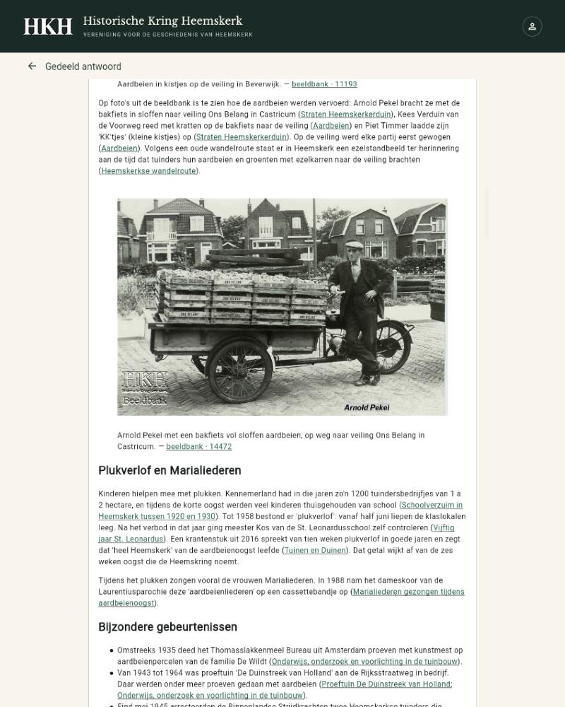
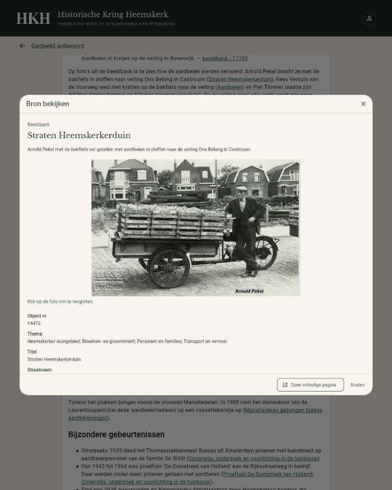

# Vragen stellen aan ons archief

Voorstel om bezoekers in gewone taal te laten zoeken in alles wat de Historische Kring Heemskerk heeft verzameld, met hulp van kunstmatige intelligentie (AI).

Voorstel voor het bestuur · oktober 2026

## In het kort

De HKH heeft ruim 18.000 foto's, documenten, boeken, bidprentjes en Heemskring-artikelen gedigitaliseerd. Wie daar iets in wil vinden, moet nu weten in welke van de zes beeldbanken het staat en welk zoekwoord werkt. 
Dit voorstel voegt één vraagveld toe: je typt een vraag zoals je die aan een historicus zou stellen. Een digitale onderzoeker zoekt dan in alle collecties tegelijk en schrijft een samenvatting en zet er de bronnen bij.

### Wat wordt gevraagd

- Aanschaf van een computer: eenmalig ongeveer € 900.
- Een AI-abonnement van € 18 per maand (maandelijks opzegbaar). Alleen bij veel gebruik is een zwaarder abonnement van € 90 per maand nodig.
- Evaluatie na een half jaar: wordt het gebruikt, en wat kost het werkelijk?

De techniek is al gebouwd en getest en draait op een PC bij Robbert en is te testen op https://hkh.vdzonsoftware.nl/

## 1. De huidige manier van zoeken

Onze collecties zijn goed beschreven, maar verdeeld over zes aparte beeldbanken, elk met een eigen zoekscherm en eigen zoekvelden. Een bezoeker die wil weten wat er bekend is over bijvoorbeeld de aardbeienteelt, moet:

- weten dat er een archiefbank, een fotobank, een bibliotheekbank, een bidprentjesbank, een artikelenbank en een objectenbank zijn;
- in elke bank apart zoeken, met het juiste zoekwoord en het juiste veld;
- de gevonden stukken zelf lezen en combineren tot een antwoord.

De zoekschermen zijn ook vrij complex voor personen die voor de eerste keer wat willen zoeken in het archief. 

## 2. Voorstel voor een nieuwe manier van zoeken

De bezoeker ziet een eenvoudig scherm met één veld. Hij typt een vraag in gewone taal. De digitale onderzoeker doorzoekt alle collecties, leest de gevonden stukken en schrijft een samenvatting. 
Onder elk antwoord staat de lijst met bronnen, met een link naar het originele stuk in onze eigen collectie. Elk antwoord is dus te controleren.

Wie liever zelf zoekt, kan dat blijven doen: de bestaande zoekschermen met filters op straat, thema, periode en auteur blijven bestaan en zijn vanaf hetzelfde scherm bereikbaar.

## 3. Een echt voorbeeld

Hieronder staat, letterlijk overgenomen, het antwoord dat de digitale onderzoeker op de proefomgeving gaf op de vraag "Wat is er bekend over de aardbeienteelt in Heemskerk?". Het antwoord is in één zoekronde gemaakt en kostte 2 minuten en 13 seconden.

Op het scherm staat bij elk antwoord de waarschuwing dat het door AI is samengesteld en dat de bronnen leidend zijn.

Wie op een bron klikt, ziet het originele stuk zoals het in onze eigen beeldbank (ZCBS) staat: de foto of het document, het objectnummer, de titel, het thema en de overige velden. Zo kan iedereen de samenvatting controleren aan de hand van de bron.

## 4. Wat het kost

| Onderdeel | Eenmalig | Per maand | Per jaar |
|---|---|---|---|
| Computer in het Historisch Huis | € 900 | – | – |
| AI-abonnement bij normaal gebruik | – | € 18 | € 216 |
| AI-abonnement bij veel gebruik (alleen als het druk wordt) | – | € 90 | € 1.080 |

Eerste jaar: ongeveer € 1.100 (computer plus abonnement). Daarna: ruim € 200 per jaar. Alleen als het zo populair wordt dat het drukker is dan verwacht, groeit dat naar ongeveer € 1.100 per jaar. Het abonnement is maandelijks opzegbaar; de computer blijft hoe dan ook bruikbaar voor de werkgroepen.

## Zelf proberen

De proefomgeving staat op https://hkh.vdzonsoftware.nl. Typ een vraag en klik op "Zoek"; het antwoord verschijnt meestal binnen twee minuten. Probeer bijvoorbeeld:

- Wat is er bekend over de aardbeienteelt in Heemskerk?
- Wie woonden er rond 1900 aan de Kerkweg?
- Wat gebeurde er in Heemskerk tijdens de Tweede Wereldoorlog?

Onderaan het zoekscherm staat een schakelaar "Nieuwe website". Daarachter staat, ter kennismaking, een proefversie van een vernieuwde website met dezelfde inhoud als de huidige site. Daar hoeft het bestuur nu niets over te besluiten.
